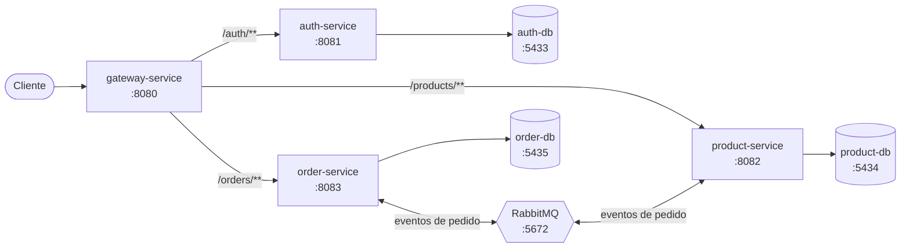

# E-commerce com Microsserviços

Projeto de portfólio com arquitetura de microsserviços em Java 21, Spring Boot 4.1.1 e Spring Cloud 2025.1.2. Um API Gateway é o único ponto de entrada: ele valida o JWT e repassa as chamadas para os serviços internos.

## Arquitetura



## Serviços

| Serviço | Porta | Responsabilidade | Banco |
|---|---|---|---|
| gateway-service | 8080 | Ponto de entrada, validação de JWT | — |
| auth-service | 8081 | Cadastro, login e emissão de JWT | auth-db (5433) |
| product-service | 8082 | CRUD de produtos e ajuste de estoque | product-db (5434) |
| order-service | 8083 | Criação de pedidos (assíncronos) | order-db (5435) |
| RabbitMQ | 5672 / 15672 | Mensageria entre order e product | — |

## Fluxo de autenticação

1. O cliente faz login em `POST /auth/login` pelo gateway e recebe um JWT.
2. Nas demais rotas, envia o token no header `Authorization: Bearer <token>`.
3. O gateway valida a assinatura e a expiração. Se o token for inválido ou não existir, responde `401`.
4. Se for válido, o gateway repassa a chamada e envia o identificador do usuário no header `X-User-Id`.

Rotas `/auth/**` são públicas. As rotas `/products/**` e `/orders/**` exigem token.

## Fluxo de pedido

1. `POST /orders` cria o pedido com status `PENDING`.
2. O order-service publica uma mensagem no RabbitMQ.
3. A mensagem é processada e o pedido vira `CONFIRMED` ou `CANCELLED`.

## Como rodar

Pré-requisitos: Java 21, Docker Desktop (com o Engine em execução) e Windows com PowerShell.

1. Suba a infraestrutura (bancos e RabbitMQ):

```powershell
docker compose up -d
```

2. Em uma janela do PowerShell para cada serviço, entre na pasta e rode:

```powershell
.\mvnw spring-boot:run
```

Ordem sugerida: auth-service, product-service, order-service e, por último, gateway-service. Deixe cada janela aberta: fechá-la encerra o serviço.

## Testes

Os testes do gateway cobrem o filtro JWT (sem token, token inválido, token válido e rota pública):

```powershell
cd gateway-service; .\mvnw test
```

## Configuração

A chave de assinatura dos JWTs vem da variável de ambiente `JWT_SECRET`. Se ela não existir, é usado um valor padrão, apenas para desenvolvimento. Em qualquer ambiente real, defina um valor forte e secreto.

## Próximos passos

- Observabilidade (métricas e logs centralizados)
- CI/CD
- Passar o id numérico do usuário no `X-User-Id`, em vez do email 